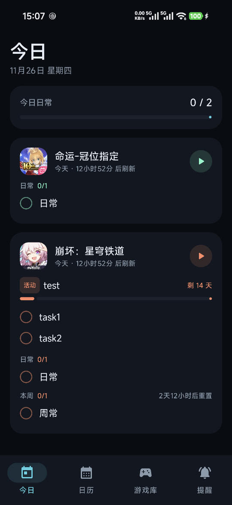
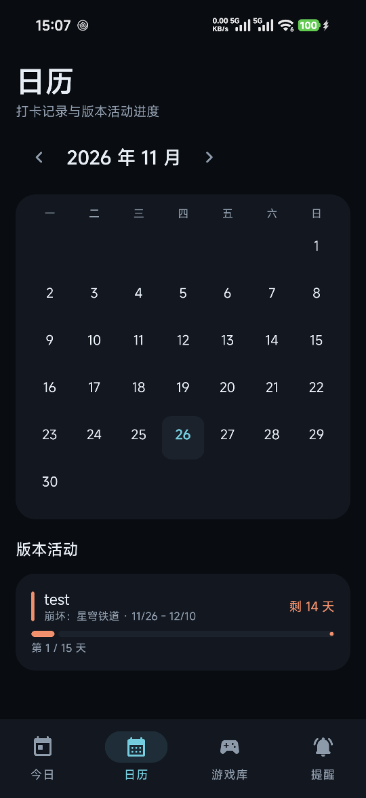
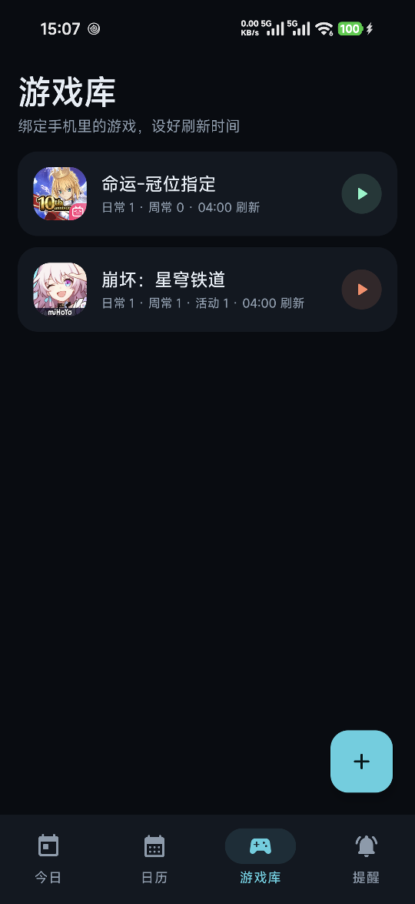
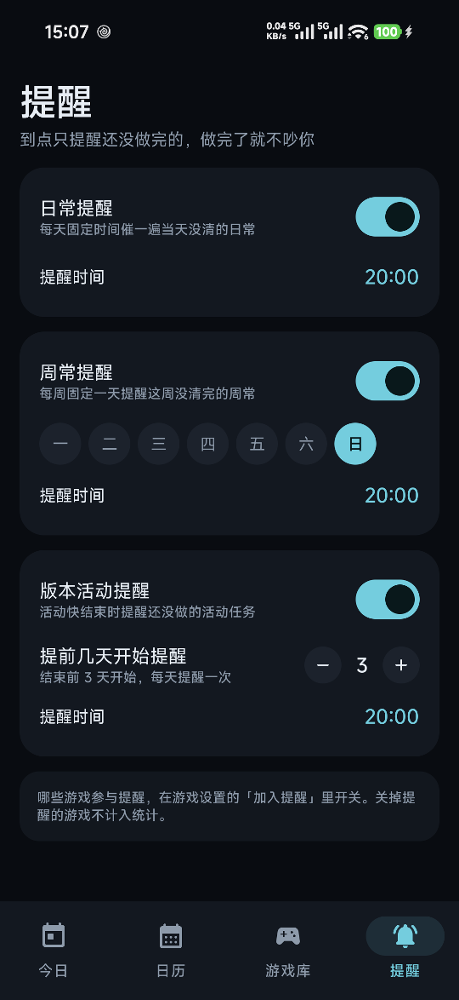
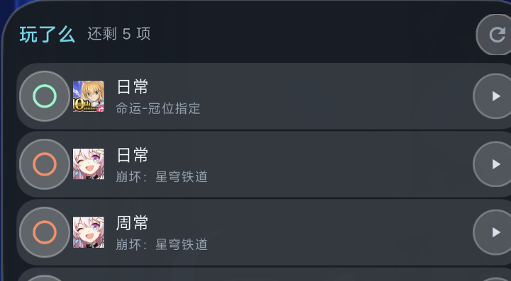

# 玩了么 · GameTodo

给玩家用的游戏待办：日常、周常、版本活动该做的事一目了然，勾一下就知道今天还差什么。
刷新时间按游戏自己定（不是 0 点），绑上手机里的游戏还能从桌面一键启动。

<p align="center">
  
  &nbsp;&nbsp;
  
</p>

## 功能

- **日常 / 周常 / 版本活动** 三类任务，分开统计完成度
- **按游戏自定义刷新时间**：默认 04:00，凌晨跨天不会算错日子；每周刷新日也能设
- **绑定本机游戏**：自动识别已安装游戏，一键启动，图标直接用游戏原图
- **版本活动**：起止日期 + 活动内子任务，活动结束任务自动失效、不再出现在今日
- **打卡日历**：月历看哪天清完过，版本活动在底部以进度条展示剩余天数
- **统一提醒**：每日固定时间催日常、每周固定日催周常、活动结束前 N 天催活动任务
- **桌面小部件**：今日未完成清单，行内勾选、行内启动游戏、可滚动

## 提醒是通知，不是闹钟

到点只弹一条普通通知（默认重要级别，一声提示音），不会弹全屏闹钟、不会响个不停。
已经清完的那天不会打扰你。

## 截图

| 游戏库 | 提醒设置 |
|:--:|:--:|
|  |  |

**桌面小部件**：左边勾选、中间游戏图标和任务、右边一键启动



> 小部件在「长按桌面 → 小部件 → 全部应用 → 安卓小部件」里，第三方 App 的部件小米/HyperOS 只收在这个分类下。

## 下载安装

从 [`release/GameTodo-1.0.0.apk`](release/GameTodo-1.0.0.apk) 下载，传到手机安装即可（首次需允许「安装未知应用」）。

```bash
adb install -r release/GameTodo-1.0.0.apk
```

首次使用建议把两个权限给上，否则提醒不会响：

- 通知权限（Android 13+ 会主动询问）
- 精确闹钟（Android 12+ 在系统「特殊应用权限」里，App 内开启提醒时会引导）

## 使用

1. **游戏库 → 右下角 +** 绑定手机里的游戏，设好每天的刷新时间
2. 点游戏卡片进详情：加日常、周常任务，加版本活动
3. 版本活动里可以继续加子任务，这些任务只在活动期间出现
4. **提醒**页统一设置提醒时间和开关，不需要的游戏在小部件/游戏设置里单独关
5. 桌面加小部件，随时勾掉今天的活儿

## 技术栈

- Kotlin + Jetpack Compose（Material 3）、Navigation-Compose
- Room 存游戏、任务、活动、打卡记录
- 提醒：`AlarmManager` 精确闹钟 → 发普通通知
- 小部件：`RemoteViews` + `RemoteViewsService`（ListView），图标通过 `content://` 提供给桌面进程
- minSdk 26（Android 8.0），targetSdk 35

## 自己构建

```bash
./gradlew assembleDebug      # 调试包
./gradlew assembleRelease    # 正式包，需要签名配置
```

正式包签名读根目录的 `keystore.properties`（不入库）：

```properties
storeFile=keystore/gametodo-release.jks
storePassword=******
keyAlias=gametodo
keyPassword=******
```

没有这个文件时 release 会退回 debug 签名，方便别人 clone 下来直接出包，但不能覆盖安装官方发布的版本。

## 版本号

`大版本.小版本.迭代序列`，例如 `1.0.0`：

- **大版本**：大型更新或重构
- **小版本**：对外发包
- **迭代序列**：打包迭代

`versionCode` 按 `大*10000 + 小*100 + 迭代` 编码（1.0.0 = 10000）。

## 数据与隐私

所有数据都只存在本机的 Room 数据库里，App 不发任何网络请求、不上传任何内容。
卸载 App 即清空数据。

## License

[MIT](LICENSE)
